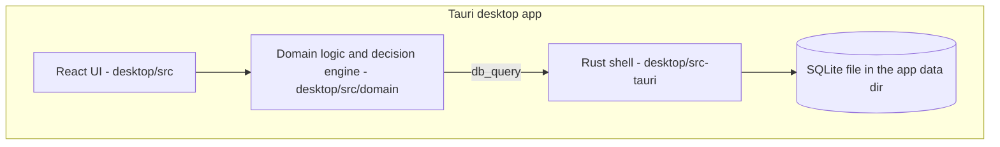

# CIBI (Can I Buy It?) - Project Specification & PRD

## 1. Vision & Core Philosophy
**CIBI**: Personal financial decision engine. Focuses on **future purchasing power** (not historical categorization).

**Equation**: `Purchasing Power = Balance - ∑(Recurring Obligations) - Safety Buffer`

Goal: Instant answer to *"If I buy this now, am I okay until next paycheck?"*

---

## 2. Domain Guidelines & Logic
All interfaces (the desktop UI) must adhere to these rules:

### 2.1 Reserved Funds Concept
- **Liquid**: Available now
- **Reserved**: Balance "spoken for" by upcoming obligations (rent, utilities, etc.)

### 2.2 Transaction Types
- **One-off**: Single impact
- **Recurring**: Frequency (daily/weekly/monthly) + next_occurrence
- **Forecasted**: Virtual txn predicting future balance

### 2.3 "Can I Buy It?" Decision Engine
1. Current balance
2. Project recurring txns from `now` to `next_payday`
3. Subtract sum from balance
4. Compare against item cost + Safety Buffer

---

## 3. System Architecture

CIBI keeps its domain logic (TypeScript in `desktop/src/domain`) separate from the desktop UI and from the SQLite access in the Rust shell. There is no HTTP server.

### 3.1 High-Level Diagram (Logical)

### 3.2 Tech Stack
*   **Shell:** Tauri 2 (Rust). One window, a tray icon, a single instance, start at login (which starts hidden), and close hides the window.
*   **UI:** React and TypeScript on Vite, with Tailwind CSS, Radix/shadcn components, TanStack Query and Router, and Recharts.
*   **Domain:** TypeScript in `desktop/src/domain`, ported from the former Go server. It runs inside the app; there is no HTTP server.
*   **Database:** SQLite, one file in the app data directory (`com.ufleck.cibi`), accessed from the Rust shell with bundled SQLite (rusqlite).
*   **Tests:** Vitest with jsdom and Testing Library for the UI and domain; `cargo test` for the Rust shell.

---

## 4. Product Requirements Document (PRD)

### 4.1 Functional Requirements

#### FR1: Transaction Management
- CRUD for transactions
- Recurring logic: Weekly, Bi-weekly, Monthly, Yearly
- Manual balance adjustment

#### FR2: Decision Engine (CIBI Query)
- Input: `item_price`, `category` (optional)
- Output: `Boolean`, `Remaining_Buffer_Post_Purchase`, `Risk_Level`

#### FR3: Multi-Interface Access
- **CLI**: `cibi check 50.00 --category "Food"`
- **API**: Single source of truth for all modules
- **Web**: Dashboard (Reserved vs. Liquid)
- **MCP**: `get_financial_status()`, `check_purchase_feasibility(amount)`, `log_transaction(amount, description)`

### 4.2 Non-Functional Requirements
- **Privacy**: Zero cloud. Local data only.
- **Availability**: Accessible via Tailscale (mobile/laptop globally)
- **Latency**: <100ms calculation
- **Extensibility**: New interfaces (Telegram, etc.) plug into API without core logic changes

---

## 5. Data Schema (Core Entities)

### `Account`
* `id`: UUID
* `name`: String (e.g., "Chase Checking")
* `current_balance`: Decimal
* `currency`: String

### `Transaction`
* `id`: UUID
* `account_id`: ForeignKey
* `amount`: Decimal
* `description`: String
* `category`: String
* `timestamp`: DateTime
* `is_recurring`: Boolean
* `recurrence_rule`: String (RRULE format)
* `next_occurrence`: DateTime (null if one-off)

### `SafetyBuffer` (Global Config)
* `min_threshold`: Decimal (The amount that must always remain in the account).

---

## 6. Implementation Roadmap

### Done
*   The core engine and the `Decision Engine` in TypeScript (`desktop/src/domain`).
*   SQLite schema as a baseline migration. A database created by the former Go server is adopted in place (`user_version` set to 1).
*   The desktop UI on six routes: dashboard, accounts, transactions, friends, goals, and settings.
*   Tray icon, close-to-hide, single instance, and start at login.

### Open
*   Automated backups of the SQLite file (not implemented).
*   Sign-off on the packaged desktop build (manual walk-through).

### Removed with the Go server
*   The REST API, the CLI, the MCP server, the separate web app, Docker, and Tailscale access. None are planned for now.

***

### Instructions for Claude Code:
*   **Rule 1:** Always refer to `CIBI_SPEC.md` before implementing new features.
*   **Rule 2:** Do not bypass the domain. The UI reads and writes data through the local API client (`desktop/src/lib/api.ts`), never directly through the database, so the "Decision Engine" logic stays centralized.
*   **Rule 3:** Prioritize the `Decision Engine` accuracy above all else. If a transaction is recurring, it MUST be accounted for in all "Can I Buy It?" calculations.