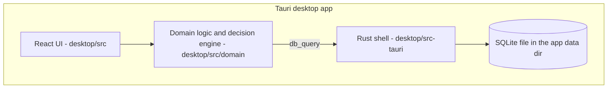

# CIBI (Can I Buy It?) - Project Specification & PRD

## 1. Vision & Core Philosophy
**CIBI**: Personal financial decision engine. Focuses on **future purchasing power** (not historical categorization).

**Equation**: `Purchasing Power = Balance - ∑(Recurring Obligations) - Safety Buffer`

Goal: Instant answer to *"If I buy this now, am I okay until next paycheck?"*

---

## 2. Domain Guidelines & Logic
All interfaces (the desktop UI) must adhere to these rules:

### 2.1 Reserved Funds Concept
- **Liquid**: Available now
- **Reserved**: Balance "spoken for" by upcoming obligations (rent, utilities, etc.)

### 2.2 Transaction Types
- **One-off**: Single impact
- **Recurring**: Frequency (daily/weekly/monthly) + next_occurrence
- **Forecasted**: Virtual txn predicting future balance

### 2.3 "Can I Buy It?" Decision Engine
1. Current balance
2. Project recurring txns from `now` to `next_payday` (a recurring txn counts once for every occurrence before `next_payday`: a weekly bill counts twice in a bi-weekly window, and an overdue one is counted until confirmed)
3. Subtract sum from balance
4. Compare against item cost + Safety Buffer

### 2.3.1 Payday plan (the UI's main screen)
- A period starts on a payday and ends on the next one. The period in progress starts today and ends on the next payday.
- The free amount of a period is `opening balance + income - bills - debts - floor`. For the current period, opening is the real balance.
- Income from the payday that starts a period is counted. A payday that is due today or overdue is **not** counted until it is confirmed: the app must never offer money that is not in the account.
- A bill due on the payday belongs to the period that starts there. An overdue bill belongs to the current period.
- A weekly bill counts once for every occurrence in the period.
- The purchase simulator applies an amount on a date, replays every period from that date, and reports the lowest closing balance. A purchase is safe only when every closing balance stays at or above the floor.
- There is no safety buffer or reserve in the UI for now: the floor is 0.

### 2.4 Monthly Budget (domain only; not in the current UI)
- **Calendar month**, one budget across all accounts. No rollover.
- **Spent**: outgoing payments in the month, grouped by category. Income and peer debts are not spent.
- **Scheduled**: recurring personal expenses whose next occurrence falls in the month, minus the bills excluded for that month.
- **Exclusions** apply to one month only. The recurring transaction itself is never changed.
- **Status** per category with a limit: `over` when spent + scheduled is more than the limit; `ahead` when spent / limit is more than the pace (day of month / days in month) + 0.12 and the category is not a fixed bill; otherwise `ok`. Fixed bills warn only when over.
- **Left** = total limits - spent - scheduled.

### 2.5 Reserve (not in the current UI)
- The reserve replaces the typed `Account.safety_buffer` once it is switched on: the engine subtracts the reserve **balance** from purchasing power. While it is off, the typed buffer applies as before.
- It is virtual: the money stays in the account. Each contribution can also be marked as moved to a real place (an investment); the domain keeps that flag.
- **Target** = `target_months` x monthly obligations. Monthly obligations are the recurring personal expenses (variable ones at their estimate) and the running installments, each converted to a month (weekly x 52/12, bi-weekly x 26/12, yearly / 12).
- **Contribution** happens when a payday is confirmed, once per payday of a pay schedule: `min(start + step x whole months since first switched on, cap percent of the pay schedule amount, target - balance)`, never below 0.
- A withdrawal needs a note and cannot exceed the balance.
- The ETA replays the coming paydays with the same formula until the balance reaches the target.

### 2.6 Variable-amount recurring expenses (existing data only)
- The current form does not create estimates; it uses the as-needed monthly budget for variable spending. Rows that already have an estimate keep working.
- A recurring expense can estimate its amount instead of fixing it: `estimate_source` is `category` (payments whose transaction category matches) or `keyword` (title or description contains the text), with `estimate_key`.
- The estimate is the **median of the latest 6** matching ledger payments (peer transfers excluded). With no history it falls back to the stored amount.
- The engine counts the estimate once for every occurrence before the next payday, as it does for every fixed recurring bill. The budget's scheduled bills use it too.
- Marking one paid asks what it really cost; that payment becomes history for the next estimate.

### 2.7 Undo and audit
- Every money movement is a `ledger` row. The account balance is the sum of the rows.
- A confirmation (bill, installment, as-needed purchase, payday or friend debt) can be undone. Undoing inserts a reversal with the opposite amount, marks the original as reversed, restores the bill's date / the installment count / the one-off pending state / the payday anchor, and recomputes the balance.
- The original and the reversal both stay in the statement. The original is shown struck through with its reversal next to it.
- The ledger row stores `occurrence_date` (the due date or payday that was settled), `reverses_entry_id` (set on the reversal) and `reversed_by_id` (set on the original).

---

## 3. System Architecture

CIBI keeps its domain logic (TypeScript in `desktop/src/domain`) separate from the desktop UI and from the SQLite access in the Rust shell. There is no HTTP server.

### 3.1 High-Level Diagram (Logical)

### 3.2 Tech Stack
*   **Shell:** Tauri 2 (Rust). One window, a tray icon, a single instance, start at login (which starts hidden), and close hides the window.
*   **UI:** React and TypeScript on Vite, with Tailwind CSS, Radix/shadcn components, and TanStack Query and Router. The Ink theme is dark by default. Inter and JetBrains Mono are bundled with `@fontsource`.
*   **Domain:** TypeScript in `desktop/src/domain`, ported from the former Go server. It runs inside the app; there is no HTTP server.
*   **Forecast:** pure TypeScript in `desktop/src/lib/forecast.ts`: pay periods, the free amount per period, and the purchase simulator.
*   **Database:** SQLite, one file in the app data directory (`com.ufleck.cibi`), accessed from the Rust shell with bundled SQLite (rusqlite).
*   **Tests:** Vitest with jsdom and Testing Library for the UI and domain; `cargo test` for the Rust shell. A small Playwright design check (`npm run design:check`) runs against the real WebView2 window.

---

## 4. Product Requirements Document (PRD)

### 4.1 Functional Requirements

#### FR1: Transaction Management
- CRUD for transactions
- Recurring logic: Weekly, Bi-weekly, Monthly, Yearly
- Manual balance adjustment

#### FR2: Decision Engine (CIBI Query)
- Input: `item_price`, `category` (optional)
- Output: `Boolean`, `Remaining_Buffer_Post_Purchase`, `Risk_Level`

#### FR3: Multi-Interface Access
- **CLI**: `cibi check 50.00 --category "Food"`
- **API**: Single source of truth for all modules
- **Web**: Dashboard (Reserved vs. Liquid)
- **MCP**: `get_financial_status()`, `check_purchase_feasibility(amount)`, `log_transaction(amount, description)`

#### FR4: Four screens
- **Plano** (`/`): the payday banner, the balance/free summary, the "Quanto posso gastar?" simulator, one card per pay period with the bills and their Pagar/Desfazer buttons, and the full bill list.
- **Extrato** (`/extrato`): every ledger entry, with Desfazer.
- **Amigos** (`/amigos`): friend debts, with Paguei/Recebi and Desfazer.
- **Ajustes** (`/ajustes`): accounts, pay schedules, theme and start at login.
- Old paths redirect to the new screens. The bill form supports a fixed recurring bill, a one-off, an installment and an as-needed monthly budget.

#### FR5: Undo
- Confirming a bill, an installment, an as-needed purchase, a payday or a friend debt can be undone. The original stays in the statement and a reversal is added; see section 2.7.

### 4.2 Non-Functional Requirements
- **Privacy**: Zero cloud. Local data only.
- **Availability**: Accessible via Tailscale (mobile/laptop globally)
- **Latency**: <100ms calculation
- **Extensibility**: New interfaces (Telegram, etc.) plug into API without core logic changes

---

## 5. Data Schema (Core Entities)

### `Account`
* `id`: UUID
* `name`: String (e.g., "Chase Checking")
* `current_balance`: Decimal
* `currency`: String

### `Transaction`
* `id`: UUID
* `account_id`: ForeignKey
* `amount`: Decimal
* `description`: String
* `category`: String, free text and nullable (migration `0003`)
* `timestamp`: DateTime
* `is_recurring`: Boolean
* `recurrence_rule`: String (RRULE format)
* `next_occurrence`: DateTime (null if one-off)

### `SafetyBuffer` (Global Config)
* `min_threshold`: Decimal (The amount that must always remain in the account).

### `ledger`
* `account_id`, `entry_type` (`payment` | `income` | `opening_balance` | `manual_adjustment`), `amount` (cents), `description`, `posted_at`.
* `transaction_id` / `pay_schedule_id` link a payment or an income to what generated it.
* `occurrence_date`: the due date (or payday) the entry settled.
* `reverses_entry_id`: set on a reversal, pointing at the original.
* `reversed_by_id`: set on the original, pointing at the reversal.
* The account balance is the sum of its ledger rows (section 2.7).

### `AppSetting` (Key-Value, migration `0002`)
* `key`: String, primary key
* `value`: Text (JSON). Legacy keys from the old dashboard: `layout.v1` (the wall/inspector layout) and `layout.base`. The current UI does not read them.

### `Budget` (migration `0004`)
* `category`: String, primary key
* `monthly_limit`: Integer, in cents, >= 0
* `is_fixed`: Boolean. Fixed bills warn only when over the limit.

### `BudgetExclusion` (migration `0004`)
* `transaction_id`: ForeignKey to `Transaction`, deleted with it
* `month`: String `YYYY-MM`. Primary key (`transaction_id`, `month`).

### `ReserveEntry` (migration `0010`)
* `account_id`, `amount` (cents, contribution > 0, withdrawal < 0), `kind` (`contribution` | `withdrawal`).
* `pay_schedule_id` and `payday` (`YYYY-MM-DD`): a contribution is unique per payday of a schedule.
* `note` (required for a withdrawal), `posted_at`, `moved_at` (set when the user moved the money to a real place).
* Reserve settings are one `AppSetting` JSON per account under `reserve.<account id>`.

### `Transaction` estimate columns (migration `0009`)
* `estimate_source`: `category` | `keyword` | null (fixed amount). `estimate_key`: the category or keyword.

### Migrations
* `0001_baseline.sql`: the baseline schema.
* `0002_app_setting.sql`: adds `AppSetting`.
* `0003_category.sql`: adds the nullable `category` column to `Transaction`.
* `0004_budget.sql`: adds `Budget` and `BudgetExclusion`. It only adds tables.
* `0009_variable_estimate.sql`: adds `estimate_source` and `estimate_key` to `Transaction`.
* `0010_reserve.sql`: adds `ReserveEntry`. It only adds a table.
* `0013_ledger_audit.sql`: adds `occurrence_date`, `reverses_entry_id` and `reversed_by_id` to `ledger`, plus indexes on `transaction_id` and `pay_schedule_id`.
* `0014_opening_balance.sql`: adds an `opening_balance` ledger row for an account that has a balance but no ledger rows (accounts created before the opening row existed).

---

## 6. Implementation Roadmap

### Done
*   The core engine and the `Decision Engine` in TypeScript (`desktop/src/domain`).
*   SQLite schema as a baseline migration. A database created by the former Go server is adopted in place (`user_version` set to 1).
*   The simplified desktop UI on four routes: **Plano**, **Extrato**, **Amigos** and **Ajustes**.
*   The payday plan: per-period free amount, overdue payday confirmation, and the purchase simulator (`desktop/src/lib/forecast.ts`).
*   Undo for bills, installments, as-needed purchases, paydays and friend debts: a reversal is added, the original stays in the statement, and the balance is recomputed.
*   Tray icon, close-to-hide, single instance, and start at login.
*   Automated backups: a WAL checkpoint every 5 minutes, a deterministic SQL dump (`cibi-latest.sql`), and binary snapshots (14 daily, 8 weekly). A restore mode (`--restore`). Push to a private git repo via `scripts/backup-push.ps1`, and restore via `scripts/restore-backup.ps1`.
*   The Ink theme (dark by default).
*   A small Playwright design check (`npm run design:check`) that asserts no horizontal overflow at two window sizes and writes screenshots.
*   Domain only, no longer in the UI: monthly budget, categories and classification, reserve, goals, group events, as-needed estimates. The data and routes remain.
*   Variable-amount recurring expenses (section 2.6): existing rows keep working; the form uses the as-needed monthly budget.

### Open
*   Sign-off on the packaged desktop build (manual walk-through).

### Removed with the Go server
*   The REST API, the CLI, the MCP server, the separate web app, Docker, and Tailscale access. None are planned for now.

***

### Instructions for Claude Code:
*   **Rule 1:** Always refer to `CIBI_SPEC.md` before implementing new features.
*   **Rule 2:** Do not bypass the domain. The UI reads and writes data through the local API client (`desktop/src/lib/api.ts`), never directly through the database, so the "Decision Engine" logic stays centralized.
*   **Rule 3:** Prioritize the `Decision Engine` accuracy above all else. If a transaction is recurring, it MUST be accounted for in all "Can I Buy It?" calculations.